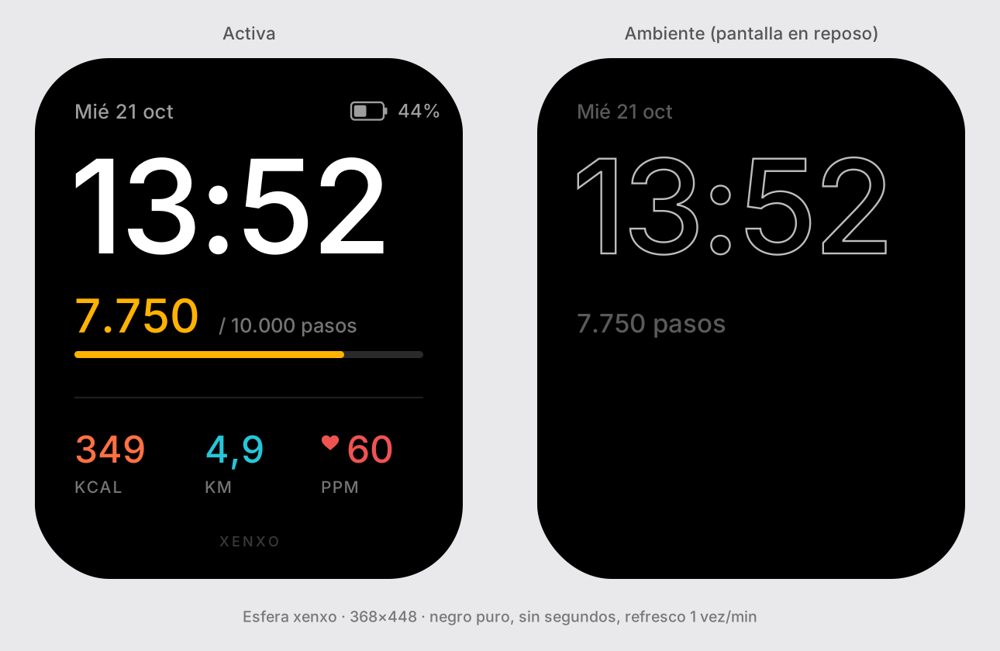
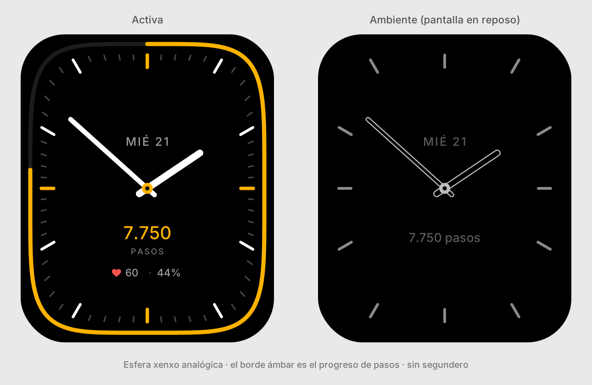

# Xenxo OS · Xiaomi Mi Watch (XMWT01)

<p align="center">
  
  &nbsp;&nbsp;&nbsp;&nbsp;
  
</p>

<p align="center">
  <strong>Suite completa de software libre y optimización extrema para el Xiaomi Mi Watch</strong><br>
  <em>Wear OS 2 China (Android 9 Pie · API 28) · Snapdragon Wear 3100 · 1 GB RAM · Pantalla AMOLED 368×448 · xenxo.io</em>
</p>

---

## 🎯 Visión del Proyecto

El **Xiaomi Mi Watch (XMWT01)** cuenta con un hardware sobresaliente (Qualcomm Snapdragon Wear 3100, 1 GB de RAM, 8 GB de almacenamiento, altavoz, micrófono, sensor barométrico, brújula magnética, NFC y batería de 570 mAh), pero adolece de software de fábrica saturado de bloatware chino, servicios en segundo plano innecesarios y falta de sincronización moderna fuera de China.

**Xenxo OS** transforma el reloj en una estación de muñeca ágil, limpia, con autonomía extendida de 3+ días, y una suite completa de aplicaciones nativas escritas en **Kotlin puro** sin dependencias pesadas de Google Play Services ni bibliotecas lentas.

Se sincroniza de forma bidireccional y sin cables con el teléfono móvil a través de [**xenxoHub**](https://github.com/xenxo-io/xenxo-phone).

---

## 🚀 Suite de Aplicaciones Integradas

| Módulo / App | Nombre en el Panal | Descripción |
|---|---|---|
| `:launcher` | **Xenxo Launcher** | Cajón de aplicaciones hexagonal estilo Apple Watch con física fluida e inercia, zoom con la corona rotatoria, y esferas Digital y Analógica personalizadas con bajo consumo AOD. |
| `:xenxo.game` | **Ruta xenxo** (`xenxoRun`) | Videojuego corredor infinito AMOLED a 60 FPS (Choreographer VSYNC). 3 carriles con perspectiva, saltos, agaches, monedas y obstáculos. Control por corona física y gestos, feedback háptico dinámico, boost con pasos reales (>3.000 pasos = 1.5x) y sincronización de récords con xenxoHub. |
| `:xenxo.gym` | **Gym Xenxo** | Registro de entrenamientos de fuerza según rutina semanal, contador de series con selector de descanso personalizable (general o por ejercicio), peso matutino por corona (0.1 kg), 1RM y sincronización bidireccional de rutinas con xenxoHub. |
| `:xenxo.padel` | **Pádel Xenxo** | Marcador táctil de partidos (15-30-40, ventaja o punto de oro, sets a 6, tie-break y super tie-break), deshacer con giro inverso de corona y modo ambiente AOD de ultra-bajo consumo. |
| `:xenxo.health` | **Salud Xenxo** | Monitor en tiempo real de pasos, distancia, calorías activas y frecuencia cardíaca óptica con lectura directa de hardware PPG. |
| `:wristai` | **Asistente IA** | Asistente multimodal impulsado por Groq LPU (Whisper STT en <500 ms + Llama 3.3 70B), Gemini Flash y Claude. Incluye atajos locales offline (<10 ms) y dashboard de 4 cuadrantes. |
| `:wristai` (Notif) | **Notificaciones** | Sistema de respuesta a notificaciones del móvil por Bluetooth con dictado por voz en castellano (Groq Whisper) y teclado de respuestas rápidas vía Android `RemoteInput`. |
| `:xenxo.tesla` | **Tesla Key Card (HCE)** | Emulación oficial por NFC Host Card Emulation (HCE) de la tarjeta física de Tesla (`secp256r1` NIST P-256 / AID `teslaLogic`). Permite abrir en pilar B y arrancar en consola central **100% offline** sin móvil. |
| `:xenxo.tesla` | **Tesla Control** | Mando a distancia del coche: control de temperatura con dial de corona (pasos de 0.5 °C), nivel de batería (%), autonomía (km), Frunk, Trunk y bloqueo. Compatible con Fleet API. |
| `:xenxo.browser` | **Navegador** | Navegador basado en Chromium adaptado a la pantalla AMOLED 368×448, scroll suave con corona rotatoria y resolvedor de portales cautivos Wi-Fi de hoteles y gimnasios (`neverssl.com`). |
| `:xenxo.intervals`| **Intervalos Xenxo** | Entrenador HIIT, Tabata (20s/10s), HIIT 30/30, 45/15 y EMOM con zonas cardíacas dinámicas (código de color PPG) y detents hápticos 3-2-1. |
| `:xenxo.outdoor` | **Outdoor Xenxo** | Altímetro barométrico (sensor MEMS TDK-Invensense `icp101xx`) con calibración QNH de presión al nivel del mar con corona + Brújula digital 360° (sensor AKM `ak0991x`). |
| `:xenxo.remote` | **Mando Remoto** | Mando multimedia Bluetooth y de presentaciones con botones táctiles grandes y control fino de volumen con la corona física. |
| `:xenxo.wol` | **Wake-on-LAN** | Emisor de paquetes mágicos UDP a la red local (`255.255.255.255:9`) para encender ordenadores y servidores del homelab con un solo toque. |
| `:xenxo.power` | **Energía Xenxo** | Monitor de consumo pasivo (%/h, temperatura, voltaje), perfiles instantáneos (Día, Noche, Entreno, Ahorro), interruptor rápido de Wi-Fi y base de datos histórica. |

---

## 🔄 Sincronización Reloj ↔ Móvil (Wear OS Data Layer)

La sincronización entre el reloj y la app del teléfono ([xenxoHub](https://github.com/xenxo-io/xenxo-phone)) utiliza el canal Bluetooth oficial de Wear OS Data Layer (`Wearable.DataClient` y `Wearable.MessageClient`).

### ⚠️ Requisito Crítico de Firma (Same Signature)
Para que el subsistema de seguridad de Wear OS permita la entrega de mensajes y datos entre las dos aplicaciones:
1. **Mismo ApplicationId**: Tanto el reloj (`:xenxo`) como el teléfono (`xenxoHub`) utilizan `io.xenxo`.
2. **Misma Clave de Firma (Keystore)**: Los APKs de ambas aplicaciones **deben estar firmados exactamente con el mismo certificado**.
   - Durante desarrollo, asegúrate de que ambos proyectos utilicen la misma clave `~/.android/debug.keystore`.
   - Para producción o releases, firma ambos APKs con tu archivo `.keystore` / `.jks` privado. Si las firmas difieren, el Data Layer descartará los paquetes en silencio.

### 📱 Particularidades de Wear OS 2 China
El Xiaomi Mi Watch XMWT01 utiliza la variante china de Wear OS. La app de compañía en el teléfono es **Wear OS China** (`com.google.android.wearable.app.cn`).
- **Iniciativa del reloj**: Debido a la gestión de ahorro de batería de Wear OS China, el servicio en segundo plano del teléfono no siempre puede despertar al reloj. Por ello, **el reloj siempre inicia el envío** (`/xenxo/v1/push`).
- **Respuesta en el teléfono**: El teléfono procesa los datos entrantes en un servicio con proceso aislado (`:wear`) y responde de inmediato con el acuse de recibo y las rutinas actualizadas (`/xenxo/v1/ack`).

---

## ⚡ Optimización de Batería y Debloat

El repositorio incluye scripts en PowerShell listos para aplicar con un solo comando:

1. **Debloat de servicios en segundo plano (`scripts/debloat.ps1`)**:
   Deshabilita 12 paquetes de telemetría y servicios chinos redundantes (`com.xiaomi.wear.xiaoai`, `anonymous.xiaoai`, `hotwordle`, `onetrack.watch`, `market`, `lpa`, `card`, `mihome`, etc.) sin romper ninguna función del sistema.
   ```powershell
   .\scripts\debloat.ps1 -Aplicar
   ```

2. **Ajustes de eficiencia energética (`scripts/ajustes-bateria.ps1`)**:
   Ajusta el brillo óptimo para interiores (70/255), desactiva la búsqueda continua de redes Wi-Fi en reposo y optimiza los timeouts de pantalla.
   ```powershell
   .\scripts\ajustes-bateria.ps1 -Aplicar
   ```

3. **Diagnóstico y medición (`scripts/medir-bateria.ps1` y `scripts/diagnostico-reloj.ps1`)**:
   Inspecciona la salud real de la batería (salud física, ciclos, microamperios hora `charge_counter`) y el porcentaje de gasto horario real.

4. **Copia de seguridad y restauración completa (`scripts/backup.ps1`)**:
   Extrae al ordenador todas las bases de datos locales (`xenxo_gym.db`, `xenxo_battery.db`, `xenxo_padel.db`, `xenxo_health.db`, `xenxo_game.db`), claves privadas de la tarjeta Tesla HCE (`tesla_key_store.xml`) y configuraciones, generando un script de restauración en 1 clic.

---

## 🛠️ Arquitectura y Filosofía

- **Cero dependencias pesadas**: Todas las interfaces se construyen sobre el framework nativo de Android (`android.view.View`, Canvas 2D acelerado por hardware, `Choreographer` a 60 FPS, `ValueAnimator`).
- **Negro AMOLED Puro (`#000000`)**: Cada pantalla apaga físicamente los píxeles negros del panel AMOLED 368×448, eliminando el consumo innecesario de energía.
- **Soporte de Corona Física (Rotary Input)**: Integración en `onGenericMotionEvent` con `AXIS_SCROLL` y `AXIS_VSCROLL` en videojuegos, navegadores, controles de volumen, temporizadores y selectores numéricos con clics hápticos (`Vibrator`).
- **Criptografía estándar en chip**: La emulación Tesla NFC utiliza `java.security.KeyPairGenerator` (curva elíptica NIST P-256 / `secp256r1`), `KeyAgreement` (ECDH) y `javax.crypto.Cipher` (AES-128) garantizando autenticación segura offline.

---

## 📦 Compilación e Instalación

### Requisitos
- Android Studio Ladybug / Koala o superior (o JDK 17/21 + Android SDK Platform 28).
- Reloj conectado por Wi-Fi o cable magnético USB con **Depuración ADB** activada.

### 1. Clonar el repositorio
```bash
git clone https://github.com/xenxo-io/xenxo-watch.git
cd xenxo-watch
```

### 2. Compilar los módulos
```powershell
.\gradlew.bat assembleDebug testDebugUnitTest
```
Los APKs generados se encontrarán en:
- `launcher/build/outputs/apk/debug/launcher-debug.apk`
- `wristai/build/outputs/apk/debug/wristai-debug.apk`
- `xenxo/build/outputs/apk/debug/xenxo-debug.apk`

### 3. Instalar en el reloj vía ADB
```powershell
adb connect <IP_DEL_RELOJ>:5555

# Instalar los tres módulos
adb install -r launcher/build/outputs/apk/debug/launcher-debug.apk
adb install -r wristai/build/outputs/apk/debug/wristai-debug.apk
adb install -r xenxo/build/outputs/apk/debug/xenxo-debug.apk
```

### 4. Permisos ADB Necesarios en el Reloj
Para que el lanzador, el cambio de idioma y los perfiles de energía funcionen con acceso total:

```powershell
# Establecer xenxo Launcher como el lanzador de inicio por defecto
adb shell cmd package set-home-activity io.xenxo.launcher/.HomeActivity

# Permisos para xenxo Launcher (idioma, ajustes del sistema y complicaciones de esfera)
adb shell pm grant io.xenxo.launcher android.permission.CHANGE_CONFIGURATION
adb shell pm grant io.xenxo.launcher android.permission.WRITE_SECURE_SETTINGS
adb shell pm grant io.xenxo.launcher com.google.android.wearable.permission.RECEIVE_COMPLICATION_DATA
adb shell appops set io.xenxo.launcher WRITE_SETTINGS allow

# Permisos para xenxo Suite (ajustes de energía y sistema)
adb shell pm grant io.xenxo android.permission.WRITE_SECURE_SETTINGS
adb shell appops set io.xenxo WRITE_SETTINGS allow
```

---

## 🔑 Configuración de Wrist AI y Notificaciones

1. Copia `wristai/config.example.json` a `wristai/config.json` e introduce tus claves de API (Groq para Whisper y Llama 3.3, Gemini Flash, etc.).
2. Envía la configuración al reloj mediante ADB:
   ```powershell
   adb push wristai/config.json /sdcard/Android/data/io.xenxo.wristai/files/config.json
   ```
3. Al abrir **Asistente IA** en el reloj, importará automáticamente las credenciales a su almacenamiento seguro privado y eliminará el archivo temporal de la tarjeta SD.

---

## 📄 Licencia

Desarrollado con dedicación para la comunidad por [xenxo.io](https://xenxo.io).  
Distribuido bajo la licencia **MIT** (consulta el archivo [LICENSE](LICENSE)).  
*Nota: Este repositorio no contiene código de terceros con licencias copyleft.*
